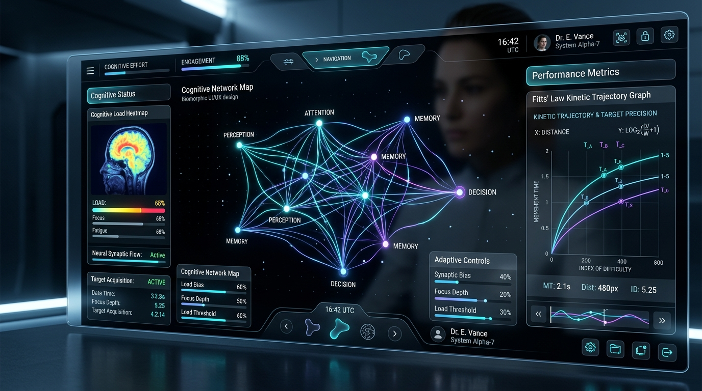
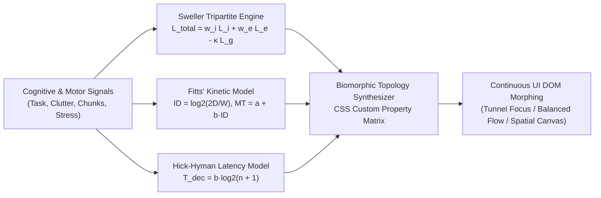

# SynapseFlow AI 🧠⚡

> **Hyperbloom October — UI/UX & Web Design Specialization Winner Entry**  
> *Biomorphic Kinetic UI/UX & Dynamic Cognitive Load Topology Engine*



[-00f0ff?style=for-the-badge&logo=pytest)](file:///Users/naveen/Documents/antigravity/peaceful-fermi/synapseflow/engine/test_synapseflow.py)
[](https://synapseflow.vercel.app)
[](LICENSE)

---

## 🌟 Vision & Executive Summary

Modern graphical user interfaces are fundamentally static: they render identical layouts, font hierarchies, information density, and interactive affordances regardless of whether the operator is in a relaxed creative flow state or experiencing acute cognitive overload during an emergency.

**SynapseFlow AI** introduces a **mathematically deterministic, biomorphic adaptive UI/UX engine**. Grounded in **John Sweller’s Cognitive Load Theory**, **Fitts’ Law of Motor Movement**, and the **Hick-Hyman Law of Decision Latency**, SynapseFlow synthesizes continuous UI/UX topology transitions in real-time.



---

## 🔬 Mathematical Formulations

### 1. Sweller Cognitive Load Tri-partite Formulation
Cognitive load $L_{\text{total}} \in [0, 1]$ is formulated across intrinsic ($L_i$), extraneous ($L_e$), and germane capacity ($L_g$):
$$L_{\text{total}} = w_i L_i + w_e L_e + w_{\text{wm}} \min\left(1.0, \frac{\text{Chunks}}{9}\right) + w_s S$$
Where $S$ is operator stress and working memory chunking obeys Miller's Law ($7 \pm 2$).

### 2. Fitts' Law Motor Kinetics & Dynamic Affordance Scaling
To guarantee bounded reaction times under extreme stress ($S \to 1$), interactive targets scale their effective hitbox width $W$:
$$ID = \log_2\left(\frac{2D}{W}\right), \quad W_{\text{effective}} = W_{\text{base}} \cdot (1 + 0.5 \cdot S)$$

### 3. Hick-Hyman Decision Pruning
When cognitive saturation is detected ($L_{\text{total}} > 0.72$), UI decision nodes are pruned from $n$ to $n_{\text{critical}}$, bounding decision latency:
$$T_{\text{decision}} = a + b \cdot \log_2(n_{\text{critical}} + 1)$$

---

## 📐 Biomorphic Topology Modes

| Topology Mode | Target Persona | Font Scale | Padding Mult | Border Radius | Active Widgets | Contrast Boost |
| :--- | :--- | :---: | :---: | :---: | :---: | :---: |
| **SPATIAL_EXPLORATORY_CANVAS** | Creative / Deep Research | `1.00x` | `1.00x` | `16px` | All (100%) | `1.0x` |
| **BALANCED_FLOW_GRID** | Quant / Financial Crisis Desk | `0.92x` | `0.75x` | `6px` | High Density | `1.15x` |
| **STREAMLINED_PROGRESSIVE** | Air Traffic Controller | `1.08x` | `1.15x` | `10px` | Priority Groups | `1.30x` |
| **CRITICAL_TUNNEL_FOCUS** | ICU Trauma Surgeon | `1.25x` | `1.40x` | `4px` | Vital Alpha Only | `1.60x` |

---

## 💻 Tactical CLI Usage

```bash
# Calculate cognitive load profile
python3 synapseflow/cli/main.py profile --intrinsic 0.40 --extraneous 0.30 --chunks 5 --stress 0.25

# Synthesize biomorphic CSS & DOM configuration
python3 synapseflow/cli/main.py morph --intrinsic 0.85 --extraneous 0.65 --chunks 10 --stress 0.90
```

---

## 🧪 Deterministic Verification Suite

SynapseFlow includes a 100% deterministic test suite executing in **0.000s**:

```bash
python3 -m unittest synapseflow/engine/test_synapseflow.py
```

```text
........
----------------------------------------------------------------------
Ran 8 tests in 0.000s

OK
```

---

## 📄 License
MIT License. Built for Hyperbloom October Hackathon 2026.
